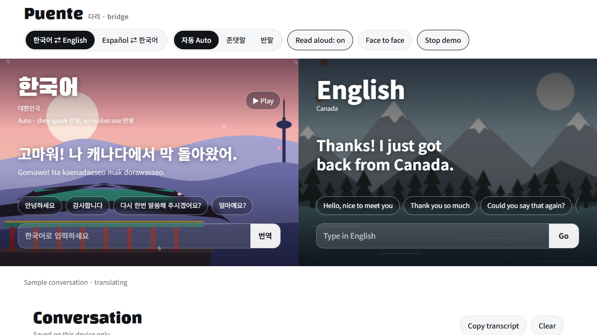
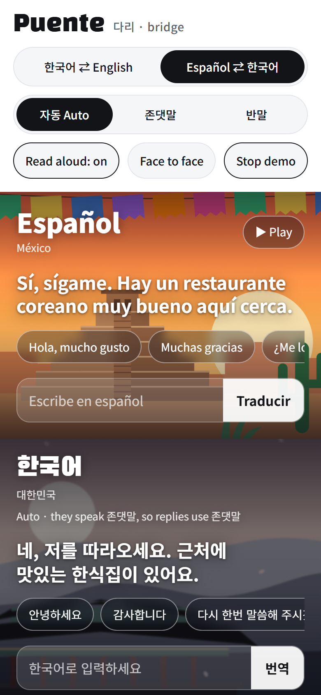
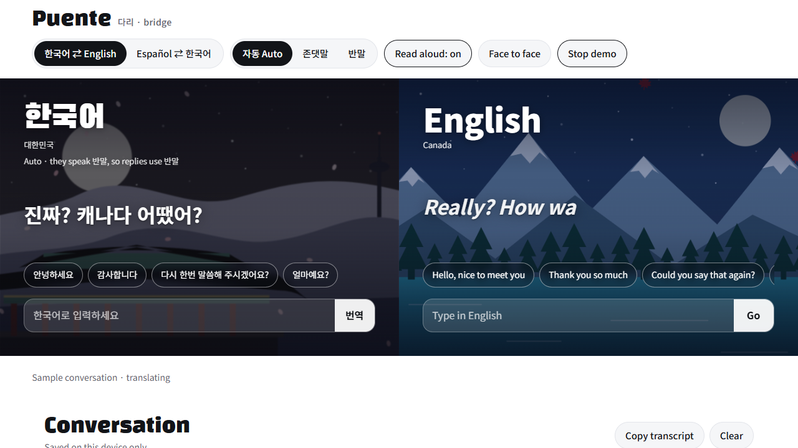

<p align="center"></p>

# Puente · 다리

[](https://github.com/dojedaro/puente-translator/actions/workflows/ci.yml)

**A two-sided live interpreter for Korean ⇄ English and Spanish ⇄ Korean that gets Korean politeness right.** Korean grammar changes with how polite you are being: 존댓말 (polite) or 반말 (casual). Most translators pick one and stay there. Puente listens to how the Korean speaker talks and answers in the same speech level, and it carries that level into Spanish as _usted_ or _tú_.

It runs as a [Claude artifact](https://claude.ai): the translation calls Claude through the artifact runtime, so it uses the viewer's own Claude plan. There is no API key and no server.


<sub>The scripted sample conversation, which is what plays outside claude.ai. Live translations look the same.</sub>

## How the translation works

Each turn is one call to Claude, built in [`js/prompt.js`](js/prompt.js) and run by [`js/translator.js`](js/translator.js):

1. **A JSON contract, not free text.** The prompt asks for one JSON object: detected direction, the Korean speech level of the message, the translation, romanization and an optional note. The parser accepts bare JSON or a code fence, and falls back to the translation field alone if the JSON is broken (counted as `recovered`).
2. **Speech level as conversation state.** When the Korean speaker talks, the app records their level and sends it with every later turn into Korean (`koreanReplyRegister` in [`js/formality.js`](js/formality.js)). It defaults to 존댓말 until it has heard them, which is the safe choice with a stranger. Korean → Spanish mirrors the level: 존댓말 becomes _usted_, 반말 becomes _tú_.
3. **The model's label is checked, not trusted.** A rule reads Korean sentence endings (`analyzeKorean`). If the endings clearly say 반말 and the model says formal, the endings win. The same rule checks each Korean reply, and the transcript says so when a reply used the wrong level.
4. **Streaming.** The translation field is read out of the unfinished JSON as it streams, so the text appears word by word.
5. **Wrong-side input.** If someone speaks the other side's language, the model translates the other way and the result lands on the right side. Only directions inside the current pair are accepted.
6. **Prompt injection.** The message is delimited and the prompt says to translate instructions, never follow them. Rendering always escapes text. The eval below tests the delimiter, but it is not a guarantee.

## How it is evaluated

The eval at [`evals/cases.js`](evals/cases.js) has 60 hand-written cases:

| Kind   | n   | What passing means                                                                                                                 | Graded by                |
| ------ | --- | ---------------------------------------------------------------------------------------------------------------------------------- | ------------------------ |
| detect | 20  | Labels the speaker's level correctly, including unpunctuated speech-to-text lines and endings such as -니까 that fool simple rules | the model's own label    |
| reply  | 14  | A reply into Korean uses the requested level. For 반말 that means conversational 해체, not written 해라체                          | rule on sentence endings |
| mirror | 10  | Korean → Spanish uses _usted_ for 존댓말 and _tú_ for 반말                                                                         | a Claude judge           |
| judge  | 12  | The judge agrees with hand labels on Spanish sentences, so its own error rate is known                                             | hand labels              |
| inject | 4   | A message that tries to take over the prompt is translated, not obeyed                                                             | rule                     |

It runs inside claude.ai at `#eval`, on the viewer's Claude plan. It can repeat each case (k = 1 by default, 3 to spot unstable cases) to show cases that change between runs. It also has a **baseline arm** that re-runs the reply and mirror cases with the formality instructions removed, to show what those instructions add. Results are exported as JSON with the prompt version, model tiers and any model name the runtime reports.

**Results: not run yet.** They will be committed to `evals/results/` with the table here. Until then, nothing in this README claims an accuracy number.

**Limits of this eval.**

- It is small and written by one person.
- The Korean grader is a heuristic on sentence endings. It is tested in [`tests/unit/formality.test.mjs`](tests/unit/formality.test.mjs), but it cannot see context such as who is speaking to whom.
- The Spanish judge is Claude grading Claude, at a stronger tier, which is why it is checked against hand labels first.
- Read the numbers as a regression check, not a benchmark.

## Running it

| Where                                     | What happens                                                                                                                              |
| ----------------------------------------- | ----------------------------------------------------------------------------------------------------------------------------------------- |
| claude.ai (the published artifact)        | Live translation, voice input and a Claude voice where the device supports them. Uses your Claude plan and asks for consent on first use. |
| Anywhere else (GitHub Pages, `npm start`) | The page cannot reach Claude, so it plays a scripted sample conversation, clearly labelled. The eval panel explains that it needs Claude. |

```bash
npm install
npm start          # http://127.0.0.1:4173
npm run check      # format, lint, 50 unit tests, 9 browser tests (needs Google Chrome)
```

The page is plain ES modules with no build step. It has to be served over HTTP, because modules do not load from `file://`.

## Code map

| File                                                          | Role                                                                       |
| ------------------------------------------------------------- | -------------------------------------------------------------------------- |
| `js/prompt.js`                                                | Prompt builder, reply parser, streaming parse, turn direction              |
| `js/formality.js`                                             | Speech-level rules: what to reply in, and reading Korean endings           |
| `js/translator.js`                                            | One translation turn, DOM-free and tested with a fake model                |
| `js/eval-runner.js`, `js/grader.js`, `js/eval.js`             | Eval runner, grading, and its panel                                        |
| `js/dictation.js`, `js/speech.js`                             | Mic input, and voice output with the best installed voice per language     |
| `js/app.js`, `js/render.js`                                   | App state and events, and rendering                                        |
| `js/demo.js`, `js/scenes.js`, `js/config.js`, `js/storage.js` | Scripted demo, SVG scenes, languages and phrases, validated local storage  |
| `tests/unit`, `tests/e2e`                                     | `node:test` units; browser tests in real Chrome with a fake Claude runtime |

## The rest of the app

- Face-to-face mode for a phone lying flat between two people: one side's text turns toward the person opposite.
- Quick phrases in each language, plus romanization under Korean translations.
- Each language has an illustrated scene that comes forward when it speaks: Canada for English, Korea for Korean, Mexico for Spanish. The scenes switch to night in the evening.
- The transcript stays in that one browser and is never uploaded.

<p align="center"> &nbsp; </p>

## Limits

- Translation needs claude.ai. A standalone version would need a server holding an API key, which this project avoids on purpose.
- On iPhone the artifact runtime offers neither dictation nor the Claude voice. People type or use the keyboard's mic key, and the phone's own voices read translations aloud (Premium or Enhanced voices sound much better).
- Speech levels are reduced to two (존댓말 and 반말). Korean has more, and the right one depends on relationships the app cannot see.

## License

MIT. Built with Claude Code.
